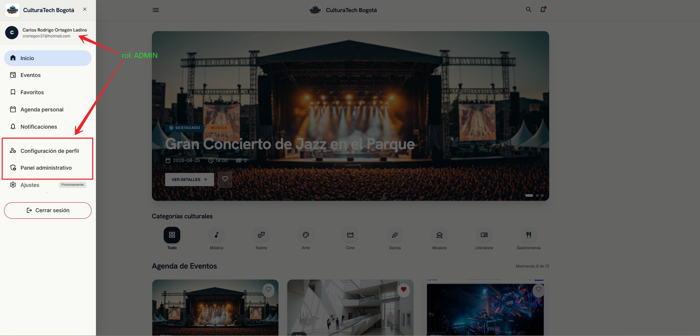
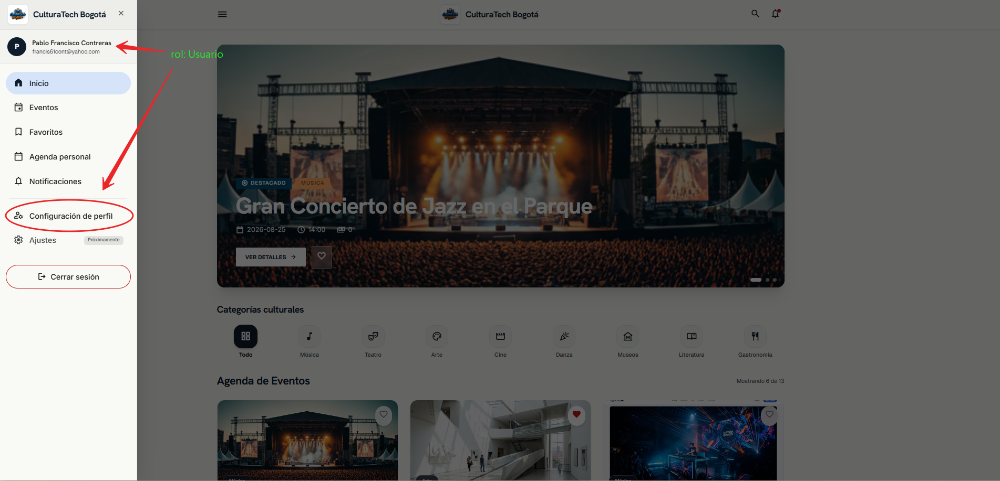
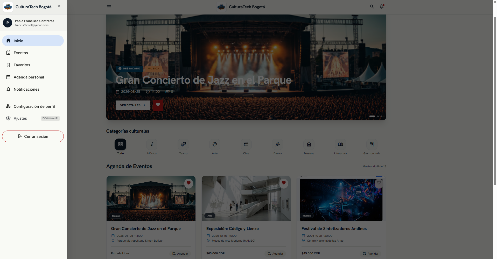
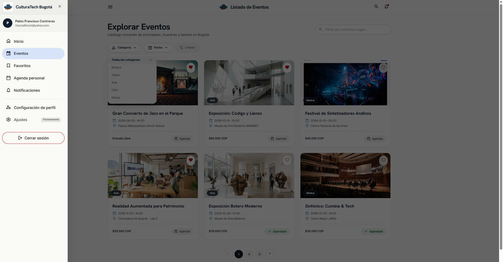
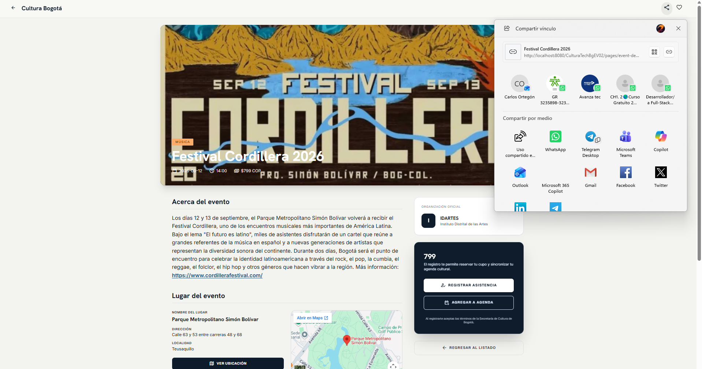
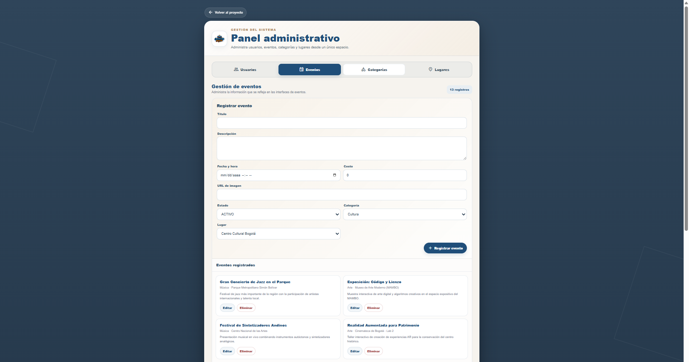
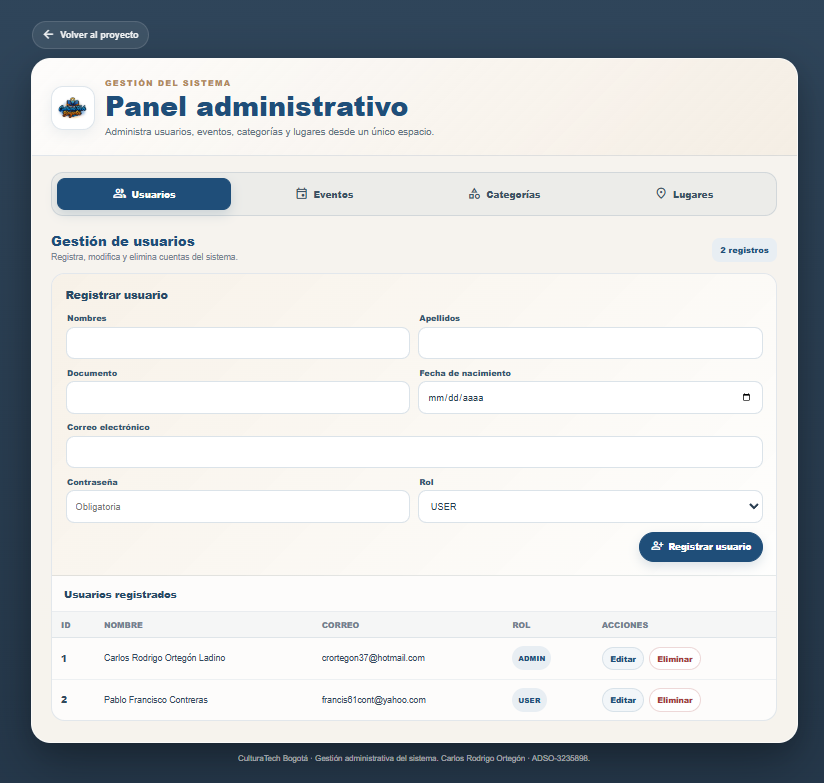
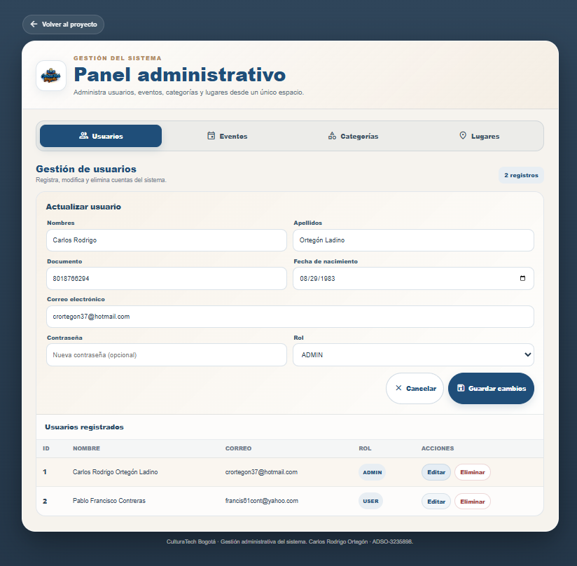
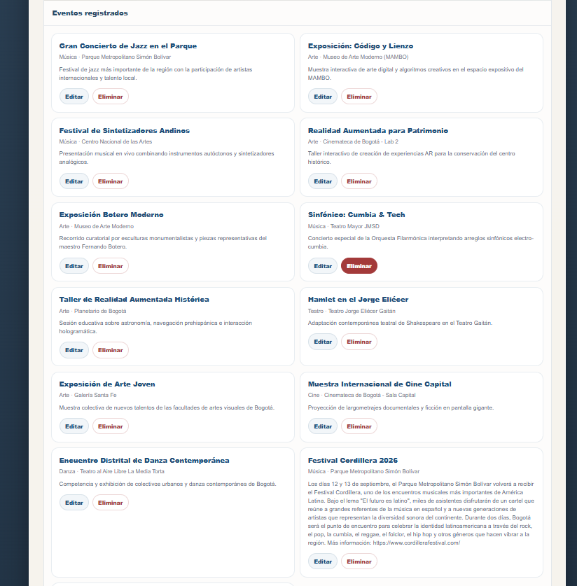

# CulturaTech Bogotá — Componente front-end con React (GA7-AA4-EV03)

## Información del proyecto

| Campo | Descripción |
|---|---|
| **Proyecto formativo** | CulturaTech Bogotá |
| **Evidencia** | GA7-AA4-EV03 — Componente front-end del proyecto formativo |
| **Backend** | Java 21, Spring Boot y Spring Web MVC |
| **Frontend** | React y Vite |
| **Persistencia** | Spring Data JPA, Jakarta Persistence (JPA), Hibernate y MySQL |
| **Construcción** | Maven para el backend y npm/Vite para el frontend |

---

## 1. Descripción general

CulturaTech Bogotá es una aplicación web para consultar y administrar información de eventos culturales, categorías, lugares y usuarios. En esta versión, la interfaz que antes estaba construida con HTML, CSS y JavaScript tradicional fue migrada a **React**. El backend existente se conserva con **Spring Boot**, y la comunicación entre ambas partes se realiza mediante una API REST que intercambia datos en formato JSON.

El frontend se desarrolla dentro de `frontend/` con React y Vite. Para el despliegue integrado, Vite compila la aplicación directamente en `src/main/resources/static/`; esa carpeta es el directorio estático que Spring Boot publica. Por esta razón, React y Spring Boot no necesitan ejecutarse como dos servidores separados cuando se utiliza la versión compilada.

La aplicación conserva los módulos de autenticación, registro, catálogo y detalle de eventos, perfil de usuario y administración. Los favoritos y la agenda personal se mantienen en el almacenamiento local del navegador (`localStorage`); no se sincronizan con MySQL mediante endpoints propios. El apartado de notificaciones permanece fuera del alcance de esta evidencia y su ruta es actualmente una vista de marcador.

## 2. Arquitectura de la aplicación

### 2.1. Componentes principales

La solución se organiza en tres capas:

1. **Interfaz React:** presenta las vistas, gestiona la navegación, los formularios y el estado de interacción.
2. **API REST Spring Boot:** recibe las solicitudes HTTP, aplica las reglas implementadas en los controladores y consulta o modifica los datos a través de repositorios.
3. **Persistencia MySQL:** almacena los usuarios, eventos, categorías y lugares. Spring Data JPA utiliza JPA e Hibernate para mapear las entidades Java con las tablas.

### 2.2. Ejecución durante el desarrollo

En desarrollo se utilizan dos servidores: Vite sirve la interfaz con recarga rápida y Spring Boot atiende la API. El proxy de Vite, declarado en `frontend/vite.config.js`, redirige las solicitudes que comienzan por `/api` hacia `http://localhost:8080`.

```text
Navegador
   |
   | Interfaz React
   v
Vite — http://localhost:5173
   |
   | Proxy de solicitudes /api
   v
Spring Boot — http://localhost:8080
   |
   | Spring Data JPA / JPA / Hibernate
   v
MySQL — base de datos culturatechbg
```

**Dirección de acceso en desarrollo:** `http://localhost:5173/`.

Esta dirección corresponde exclusivamente al servidor de desarrollo de Vite. Para trabajar con las operaciones que consultan o modifican datos, también debe estar activo Spring Boot y debe existir conexión con MySQL.

### 2.3. Ejecución integrada o de producción

Para ejecutar la aplicación integrada, primero se construye el frontend. La configuración `build.outDir` de Vite sobrescribe el directorio predeterminado y apunta a `../src/main/resources/static`; además, `emptyOutDir: true` limpia ese destino antes de generar la nueva compilación.

El resultado incluye `index.html` y los recursos versionados de JavaScript y CSS dentro de `src/main/resources/static/`. Después Maven empaqueta el proyecto y Spring Boot sirve tanto la interfaz como los endpoints REST desde el mismo servidor.

```text
Navegador
   |
   | Interfaz compilada (index.html + assets)
   v
Spring Boot — http://localhost:8080
   |
   | Endpoints REST /api/**
   v
Spring Data JPA / JPA / Hibernate
   |
   v
MySQL — base de datos culturatechbg
```

**Dirección de acceso en ejecución integrada:** `http://localhost:8080/`.

En este modo no se inicia el servidor de desarrollo de Vite. Es suficiente con MySQL y la aplicación Spring Boot, siempre que previamente se haya generado la compilación de React. La configuración de reenvío SPA (`SpaForwardingConfig.java`) permite que rutas del cliente como `/events` sean atendidas por la aplicación React; esta ruta fue verificada durante el desarrollo.

> **Importante:** `localhost:5173` es la dirección de desarrollo; `localhost:8080` es la dirección de la aplicación integrada servida por Spring Boot. No deben confundirse ambos modos de ejecución.

---

## 3. Tecnologías utilizadas

| Tecnología | Uso dentro del proyecto |
|---|---|
| **Java 21** | Lenguaje del backend; versión declarada en `pom.xml`. |
| **Spring Boot 4.1.1** | Configuración, arranque y ejecución de la aplicación backend. |
| **Spring Web MVC** | Exposición de controladores y endpoints REST. |
| **Spring Data JPA** | Implementación de repositorios y operaciones de persistencia. |
| **Jakarta Persistence (JPA)** | Anotaciones y contratos para mapear entidades y relaciones. |
| **Hibernate** | Proveedor ORM que implementa JPA y traduce operaciones sobre entidades a operaciones SQL. |
| **MySQL 8** | Sistema gestor de la base de datos `culturatechbg`. |
| **MySQL Connector/J** | Controlador de conexión JDBC utilizado por la aplicación para comunicarse con MySQL. |
| **React 19** | Construcción de la interfaz mediante componentes. |
| **React Router DOM** | Navegación interna y definición de rutas públicas y protegidas. |
| **Vite 8** | Servidor de desarrollo y herramienta de compilación del frontend. |
| **Axios** | Cliente HTTP usado por los servicios del frontend. |
| **Tailwind CSS 4** | Utilidades de estilos integradas con Vite, junto con las hojas de estilo del proyecto. |
| **Maven** | Administración de dependencias, pruebas y empaquetado del backend. |
| **Node.js y npm** | Entorno para instalar dependencias y ejecutar los scripts del frontend. |
| **Git** | Control de versiones del proyecto. |

### 3.1. Cómo se gestiona la persistencia

La conexión a MySQL utiliza una URL JDBC y el controlador MySQL Connector/J, pero la aplicación no se documenta como una implementación basada únicamente en JDBC directo. La persistencia de las entidades se gestiona mediante **JPA**, con **Spring Data JPA** y **Hibernate**:

- **JPA (Jakarta Persistence)** define las anotaciones y el modelo de persistencia. Por ejemplo, `@Entity`, `@Id`, `@ManyToOne` y `@JoinColumn` describen el mapeo entre clases y tablas.
- **Hibernate** implementa el mapeo objeto-relacional (ORM), administra las entidades y traduce las operaciones de persistencia a SQL.
- **Spring Data JPA** proporciona repositorios, como `EventoRepository`, `UsuarioRepository`, `CategoriaRepository` y `LugarRepository`, que extienden `JpaRepository`.
- **MySQL** almacena los registros y las relaciones correspondientes.

La entidad `Evento` mantiene relaciones `ManyToOne` con `Categoria` y `Lugar`. La entidad `Usuario` utiliza el tipo enumerado `Rol` para distinguir los roles `USER` y `ADMIN`.

El controlador JDBC es el mecanismo de conexión con MySQL; JPA/Hibernate y Spring Data JPA conforman la capa de persistencia utilizada por el código de la aplicación.

---

## 4. Organización de carpetas y responsabilidades

### 4.1. Estructura general

```text
culturatech-EV03/
├── database/
│   ├── culturatechbg-ev01.sql
│   └── crear_administrador.sql
├── docs/
│   └── evidencias/
│       ├── acceso-admin.png
│       ├── acceso-usuario.png
│       ├── admin-edicion.png
│       ├── admin-eliminacion.png
│       ├── admin-eventos.png
│       ├── admin-formulario.png
│       ├── detalle-evento.png
│       ├── eventos-usuario.png
│       └── home-usuario.png
├── frontend/
│   ├── public/assets/images/
│   ├── src/
│   │   ├── api/
│   │   ├── components/
│   │   │   ├── common/
│   │   │   └── layout/
│   │   ├── context/
│   │   ├── utils/
│   │   ├── views/
│   │   ├── App.jsx
│   │   ├── main.jsx
│   │   ├── estilos.css
│   │   └── index.css
│   ├── index.html
│   ├── package.json
│   ├── package-lock.json
│   └── vite.config.js
├── src/main/
│   ├── java/com/culturatech/culturatechev03/
│   │   ├── config/
│   │   │   └── SpaForwardingConfig.java
│   │   ├── controller/
│   │   ├── model/
│   │   ├── repository/
│   │   ├── util/
│   │   └── CulturatechEv03Application.java
│   └── resources/
│       └── static/
│           ├── assets/
│           └── index.html
├── src/test/java/
├── .gitignore
├── mvnw
├── mvnw.cmd
└── pom.xml
```

Los archivos `index-*.js` y `index-*.css` que aparecen dentro de `src/main/resources/static/assets/` son recursos generados por la compilación de Vite. Sus nombres pueden cambiar entre compilaciones debido al identificador hash.

### 4.2. Frontend React

| Carpeta o archivo | Responsabilidad |
|---|---|
| `frontend/src/main.jsx` | Punto de entrada de React. Importa los estilos globales y monta el componente principal en el elemento `root`. |
| `frontend/src/App.jsx` | Configura `BrowserRouter`, las rutas de la aplicación y los componentes de protección de rutas privadas y administrativas. |
| `frontend/src/api/apiClient.js` | Crea la instancia Axios con `baseURL: '/api'`, envío de credenciales y tratamiento común de errores HTTP. |
| `frontend/src/api/auth.service.js` | Centraliza las solicitudes de autenticación, sesión, perfil, actualización de datos, cambio de contraseña y eliminación de cuenta. |
| `frontend/src/api/events.service.js` | Centraliza las consultas y operaciones CRUD de eventos. |
| `frontend/src/api/categories.service.js` | Centraliza las consultas y operaciones CRUD de categorías. |
| `frontend/src/api/places.service.js` | Centraliza las consultas y operaciones CRUD de lugares. |
| `frontend/src/api/users.service.js` | Centraliza las consultas y operaciones CRUD de usuarios. |
| `frontend/src/context/AuthContext.jsx` | Mantiene el usuario autenticado, verifica la sesión con `/api/auth/perfil`, expone las acciones de inicio y cierre de sesión y determina si el usuario tiene rol `ADMIN`. |
| `frontend/src/context/AppContext.jsx` | Comparte eventos cargados para la interfaz, favoritos, agenda y estados visuales del menú lateral y del modal de búsqueda. Favoritos y agenda se guardan en `localStorage`. |
| `frontend/src/utils/eventNormalizer.js` | Adapta los nombres de campos del backend al formato que consumen las vistas React. |
| `frontend/src/components/common/` | Contiene componentes reutilizables de interfaz, como `Logo`, `CaptchaModal` y `PasswordStrengthMeter`. |
| `frontend/src/components/layout/` | Contiene la estructura compartida de navegación: `MainLayout`, `Header`, `Drawer`, `BottomNav`, `Footer` y `SearchModal`. |
| `frontend/src/views/` | Contiene las vistas de inicio, catálogo, detalle, favoritos, agenda, login, registro, perfil y administración. |
| `frontend/src/estilos.css` y `frontend/src/index.css` | Definen los estilos de la aplicación. |

#### Responsabilidades de los componentes de interfaz

- **`MainLayout`** reúne los elementos comunes que envuelven las vistas privadas: encabezado, menú lateral, navegación inferior, pie de página y contenido de la ruta activa.
- **`Header`** presenta la cabecera y accesos principales de la aplicación.
- **`Drawer`** ofrece la navegación lateral y accesos de usuario según el estado de autenticación y el rol.
- **`BottomNav`** presenta navegación inferior para pantallas pequeñas.
- **`Footer`** contiene el pie de página y enlaces complementarios.
- **`SearchModal`** permite buscar eventos desde la interfaz común utilizando la colección de eventos cargada en `AppContext`.
- **`Logo`** centraliza la presentación de la marca CulturaTech Bogotá.
- **`CaptchaModal`** presenta la casilla de verificación utilizada en el flujo del formulario de acceso. No corresponde a una integración con un proveedor CAPTCHA externo.
- **`PasswordStrengthMeter`** muestra el cumplimiento de los criterios de longitud, mayúsculas, minúsculas, números y caracteres especiales.

#### Responsabilidades de las vistas

| Vista | Responsabilidad funcional |
|---|---|
| `HomeView.jsx` | Presenta el inicio, eventos destacados y accesos a categorías; permite marcar favoritos y agregar eventos a la agenda. |
| `EventsView.jsx` | Presenta el catálogo, búsqueda por texto, filtros por categoría y fecha, paginación y accesos a detalle, favoritos y agenda. |
| `EventDetailView.jsx` | Muestra los datos disponibles del evento seleccionado, con acciones para compartir, guardar en favoritos o agregar a la agenda. Obtiene el evento desde la colección compartida por `AppContext`. |
| `FavoritesView.jsx` | Presenta los eventos marcados como favoritos y permite retirarlos de esa lista. |
| `AgendaView.jsx` | Presenta los eventos agregados a la agenda personal y permite quitarlos. |
| `LoginView.jsx` | Gestiona el formulario de inicio de sesión, validaciones de entrada, verificación visual y bloqueo temporal del formulario tras intentos fallidos. |
| `RegisterView.jsx` | Gestiona el registro de nuevos usuarios y las validaciones de sus campos. |
| `ProfileView.jsx` | Permite consultar y actualizar datos personales, cambiar la contraseña y solicitar la eliminación de la cuenta. |
| `AdminView.jsx` | Reúne las secciones administrativas para gestionar usuarios, eventos, categorías y lugares. |

### 4.3. Backend Spring Boot

| Paquete o archivo | Responsabilidad |
|---|---|
| `CulturatechEv03Application.java` | Clase principal que inicia Spring Boot. |
| `config/SpaForwardingConfig.java` | Reenvía las rutas de navegación de la SPA al documento `index.html`, para que React Router pueda resolver rutas del cliente al acceder directamente desde el servidor integrado. |
| `controller/AuthController.java` | Atiende las operaciones de inicio y cierre de sesión, consulta del perfil, actualización de datos, cambio de contraseña y eliminación de cuenta. |
| `controller/UsuarioController.java` | Expone las operaciones de usuarios y las comprobaciones de sesión/rol que correspondan a cada operación. |
| `controller/EventoController.java` | Expone las operaciones REST de eventos. |
| `controller/CategoriaController.java` | Expone las operaciones REST de categorías. |
| `controller/LugarController.java` | Expone las operaciones REST de lugares. |
| `model/` | Contiene las entidades JPA `Usuario`, `Evento`, `Categoria`, `Lugar` y el enumerado `Rol`. |
| `repository/` | Contiene las interfaces Spring Data JPA para acceso y persistencia de entidades. |
| `util/PasswordUtil.java` | Incluye las funciones de generación y verificación de hashes de contraseña mediante PBKDF2WithHmacSHA256. |

El backend de esta versión no presenta un paquete independiente `service/`: los controladores utilizan directamente los repositorios definidos en `repository/`. La documentación refleja esa organización real en lugar de describir una capa de servicios que no está presente en el árbol revisado.

---

## 5. Rutas de navegación del frontend

| Ruta | Acceso | Vista o comportamiento |
|---|---|---|
| `/login` | Pública | Inicio de sesión (`LoginView`). |
| `/register` | Pública | Registro (`RegisterView`). |
| `/` | Usuario autenticado | Inicio (`HomeView`) dentro de `MainLayout`. |
| `/events` | Usuario autenticado | Catálogo de eventos (`EventsView`). |
| `/events/:id` | Usuario autenticado | Detalle del evento (`EventDetailView`). |
| `/favorites` | Usuario autenticado | Favoritos (`FavoritesView`). |
| `/agenda` | Usuario autenticado | Agenda personal (`AgendaView`). |
| `/perfil` | Usuario autenticado | Configuración de perfil (`ProfileView`). |
| `/admin` | Usuario autenticado con rol `ADMIN` | Panel administrativo (`AdminView`). |
| `/notifications` | Usuario autenticado | Vista de marcador; el módulo de notificaciones no forma parte del alcance implementado. |

`PrivateRoute` redirige al acceso cuando no existe una sesión autenticada. `AdminRoute` impide que un usuario sin rol `ADMIN` entre al panel administrativo y lo redirige al inicio.

---

## 6. API REST disponible

El cliente Axios utiliza la ruta base relativa `/api`, por lo que las solicitudes funcionan mediante el proxy de Vite durante el desarrollo y contra el mismo servidor Spring Boot en la ejecución integrada.

| Recurso | Métodos y rutas principales | Función |
|---|---|---|
| Autenticación y perfil | `POST /api/auth/login`, `POST /api/auth/logout`, `GET /api/auth/perfil`, `PUT /api/auth/perfil`, `PUT /api/auth/perfil/datos`, `POST /api/auth/perfil/eliminar` | Inicio/cierre de sesión, consulta y actualización del perfil, cambio de contraseña y eliminación de cuenta. |
| Usuarios | `GET /api/usuarios`, `GET /api/usuarios/{id}`, `POST /api/usuarios`, `PUT /api/usuarios/{id}`, `DELETE /api/usuarios/{id}` | Registro y operaciones de consulta, creación, actualización y eliminación de usuarios, sujetas a los controles del backend. |
| Eventos | `GET /api/eventos`, `GET /api/eventos/{id}`, `POST /api/eventos`, `PUT /api/eventos/{id}`, `DELETE /api/eventos/{id}` | Consulta y administración de eventos. |
| Categorías | `GET /api/categorias`, `GET /api/categorias/{id}`, `POST /api/categorias`, `PUT /api/categorias/{id}`, `DELETE /api/categorias/{id}` | Consulta y administración de categorías. |
| Lugares | `GET /api/lugares`, `GET /api/lugares/{id}`, `POST /api/lugares`, `PUT /api/lugares/{id}`, `DELETE /api/lugares/{id}` | Consulta y administración de lugares. |

Las rutas se encuentran declaradas en los controladores correspondientes. Los servicios JavaScript del frontend agrupan las llamadas a cada recurso para evitar que las vistas construyan directamente las solicitudes HTTP.

---

## 7. Historias de usuario y trazabilidad funcional

La trazabilidad se organiza tomando como referencia las historias de usuario identificadas en la documentación de la evidencia GA7-AA4-EV02. Se conserva su nomenclatura original; las funcionalidades administrativas adicionales se documentan por separado para evitar asignarles identificadores que no están respaldados por el catálogo.

| Historia | Descripción funcional | Componentes o vistas | Servicio/API o persistencia | Estado en esta versión |
|---|---|---|---|---|
| **HU.01 — Consulta de eventos** | Como usuario, quiero consultar el catálogo de eventos culturales para conocer las actividades disponibles. | `HomeView.jsx`, `EventsView.jsx`, `AppContext.jsx` | `events.service.js` → `GET /api/eventos` | Implementada. |
| **HU.02 — Detalle del evento** | Como usuario, quiero consultar el detalle de un evento para conocer su información. | `EventDetailView.jsx` | Datos obtenidos mediante `GET /api/eventos`; ruta `/events/:id` | Implementada. |
| **HU.03 — Filtrado de eventos** | Como usuario, quiero filtrar y buscar eventos para encontrar actividades de mi interés. | `EventsView.jsx`, `SearchModal.jsx`, `AppContext.jsx` | `events.service.js` → `GET /api/eventos` | Implementada mediante búsqueda y filtros en la interfaz. |
| **HU.04 — Favoritos** | Como usuario, quiero guardar y retirar eventos de favoritos para conservar una selección personal. | `HomeView.jsx`, `EventsView.jsx`, `EventDetailView.jsx`, `FavoritesView.jsx`, `AppContext.jsx` | `localStorage` (`culturatech_favorites`) | Implementada con almacenamiento local del navegador; no se sincroniza con MySQL. |
| **HU.05 — Notificaciones** | Funcionalidad relacionada con la consulta de notificaciones. | No aplica | No existe un recurso REST funcional de notificaciones en esta versión. | No implementada; fuera del alcance acordado para esta evidencia. |
| **HU.06 — Agenda personal** | Como usuario, quiero agregar y retirar eventos de mi agenda para consultar las actividades que he seleccionado. | `HomeView.jsx`, `EventsView.jsx`, `EventDetailView.jsx`, `AgendaView.jsx`, `AppContext.jsx` | `localStorage` (`culturatech_agenda`) | Implementada con almacenamiento local del navegador; no se sincroniza con MySQL. |
| **HU.07 — Registro e inicio de sesión** | Como visitante o usuario registrado, quiero registrarme e iniciar sesión para acceder a las funciones de la aplicación según mi cuenta y rol. | `RegisterView.jsx`, `LoginView.jsx`, `AuthContext.jsx`, `PrivateRoute`, `AdminRoute` | `users.service.js` → `POST /api/usuarios`; `auth.service.js` → `/api/auth/login`, `/api/auth/logout`, `/api/auth/perfil` | Implementada. |
| **HU.09 — Gestión de eventos** | Como administrador, quiero gestionar los eventos para mantener actualizado el catálogo cultural. | `AdminView.jsx` — sección de eventos | `events.service.js` → `/api/eventos` | Implementada mediante operaciones de consulta, creación, edición y eliminación. |
| **HU.10 — Envío de notificaciones** | Funcionalidad relacionada con el envío de notificaciones. | No aplica | No existe un recurso REST funcional para el envío de notificaciones en esta versión. | No implementada; fuera del alcance acordado para esta evidencia. |

### Funcionalidades administrativas complementarias

Además de las historias anteriores, la aplicación cuenta con operaciones administrativas verificadas que permiten gestionar otros datos del sistema:

| Funcionalidad | Componentes o vistas | Servicio/API | Estado |
|---|---|---|---|
| Gestión de usuarios | `AdminView.jsx` — sección de usuarios | `users.service.js` → `/api/usuarios` | Implementada: consulta, creación, edición y eliminación. |
| Gestión de categorías | `AdminView.jsx` — sección de categorías | `categories.service.js` → `/api/categorias` | Implementada: consulta, creación, edición y eliminación. |
| Gestión de lugares | `AdminView.jsx` — sección de lugares | `places.service.js` → `/api/lugares` | Implementada: consulta, creación, edición y eliminación. |
| Gestión del perfil | `ProfileView.jsx`, `AuthContext.jsx` | `auth.service.js` → endpoints de perfil | Implementada: actualización de datos, cambio de contraseña y solicitud de eliminación de cuenta. |

**Consideraciones de alcance:** las notificaciones no se presentan como funcionalidades implementadas. Los favoritos y la agenda personal utilizan `localStorage`, por lo que sus datos permanecen en el navegador y no constituyen persistencia en la base de datos MySQL. Las funcionalidades administrativas complementarias se documentan sin asignarles códigos de historias de usuario no confirmados.

---

## 8. Configuración de base de datos y credenciales locales

### 8.1. Preparar MySQL

1. Instalar y ejecutar MySQL 8.
2. Ejecutar el script:

```text
database/culturatechbg-ev01.sql
```

3. Verificar que exista la base de datos:

```text
culturatechbg
```

4. Desde una herramienta como MySQL Workbench. Revisar la configuración de conexión en:

```text
src/main/resources/application.properties
``` 
5. Configurar la conexión local de Spring Boot.

> **Precaución:** el archivo SQL es un volcado de base de datos y contiene sentencias `DROP TABLE`. Su importación puede eliminar y recrear tablas existentes. Antes de utilizarlo sobre una base que contenga información, realizar una copia de seguridad y confirmar que corresponde al entorno que se desea inicializar.

### 8.2. Crear la configuración local de Spring Boot

El archivo `src/main/resources/application.properties` contiene datos de conexión propios de cada equipo y no debe publicarse con contraseñas reales. En este proyecto se mantiene como archivo local excluido del control de versiones.

Después de clonar o descargar el proyecto, crear localmente `src/main/resources/application.properties` con los valores de la instalación de MySQL:

```properties
spring.application.name=culturatech-EV03
spring.datasource.url=jdbc:mysql://localhost:3306/culturatechbg
spring.datasource.username=TU_USUARIO_MYSQL
spring.datasource.password=TU_CONTRASENA_MYSQL
spring.jpa.hibernate.ddl-auto=update
spring.jpa.show-sql=true
```

Reemplazar los marcadores por las credenciales locales. No incluir contraseñas reales en el README, en commits, capturas ni paquetes de entrega. La propiedad `spring.jpa.hibernate.ddl-auto=update` permite que Hibernate actualice el esquema según las entidades; no reemplaza la necesidad de respaldar los datos antes de cambios importantes.


### 8.3. Asignar el rol ADMIN

El archivo `database/crear_administrador.sql` **no crea un usuario desde cero**. Su función es convertir en administrador (`ADMIN`) a un usuario que ya se encuentra registrado en la tabla `usuario`.

El archivo contiene tres acciones principales:

```sql
USE culturatechbg;

UPDATE usuario
SET rol = 'ADMIN'
WHERE correo = 'CORREO_DEL_ADMIN_AQUI';

SELECT id_usuario, nombres, apellidos, correo, rol
FROM usuario
WHERE correo = 'CORREO_DEL_ADMIN_AQUI';
```

### Paso a paso

**Paso 1. Registrar el usuario**

Primero se registra normalmente el usuario desde la aplicación CulturaTech Bogotá utilizando el formulario de registro.

**Paso 2. Identificar el correo**

Se toma exactamente el correo utilizado durante el registro.

**Paso 3. Abrir el script**

Desde el proyecto abrir:

```text
database/crear_administrador.sql
```

**Paso 4. Reemplazar el marcador**

Cambiar:

```sql
'CORREO_DEL_ADMIN_AQUI'
```

por el correo real del usuario que se desea convertir en administrador.

Ejemplo:

```sql
UPDATE usuario
SET rol = 'ADMIN'
WHERE correo = 'admin@ejemplo.com';
```

**Paso 5. Ejecutar el `UPDATE`**

Ejecutar la sentencia en MySQL sobre la base de datos `culturatechbg`.

**Paso 6. Verificar el resultado**

Ejecutar la consulta `SELECT` incluida en el mismo archivo y comprobar que el campo `rol` aparezca como:

```text
ADMIN
```

**Paso 7. Probar el acceso**

Ingresar nuevamente a la aplicación con las credenciales del usuario y verificar el comportamiento correspondiente al rol administrativo.

> El script debe ejecutarse sobre el usuario previamente registrado. El correo utilizado en el `UPDATE` debe coincidir con el registro existente en la base de datos.


---

## 9. Instalación y ejecución

### 9.1. Requisitos previos

- JDK 21.
- MySQL 8 y acceso al esquema `culturatechbg`.
- Node.js y npm compatibles con la versión de Vite declarada en `frontend/package.json`.
- PowerShell en Windows (los comandos siguientes están escritos para este entorno).

### 9.2. Obtener el proyecto

Clonar el repositorio:

```powershell
git clone https://github.com/Carlos7Orteg/culturatech-EV03.git
Set-Location .\culturatech-EV03
```

Antes de iniciar Spring Boot, configurar la base de datos y crear el archivo local `application.properties` siguiendo la sección anterior.

### 9.3. Instalar las dependencias del frontend

Abrir PowerShell en la raíz del proyecto e ingresar a `frontend`:

```powershell
Set-Location .\frontend
npm ci
```

`npm ci` utiliza `package-lock.json` para instalar las versiones registradas de las dependencias y crea automáticamente `frontend/node_modules/` en el equipo local. Este procedimiento se ejecuta después de clonar o descargar el proyecto y cada vez que sea necesario reconstruir las dependencias.

**La carpeta `node_modules` no se debe agregar al repositorio ni al ZIP de entrega.** Se puede regenerar mediante `npm ci`; por eso se conservan `package.json` y `package-lock.json`, y se excluye la carpeta generada.

### 9.4. Modo de desarrollo: iniciar Vite y Spring Boot

En desarrollo sí deben estar activos los dos servidores, además de MySQL.

**Terminal 1 — Backend Spring Boot**

Desde la raíz del proyecto:

```powershell
.\mvnw.cmd spring-boot:run
```

El backend queda disponible en `http://localhost:8080`.

**Terminal 2 — Frontend React con Vite**

Desde `frontend/`:

```powershell
npm run dev
```

Abrir en el navegador `http://localhost:5173/`. Vite sirve la aplicación React y redirige las solicitudes `/api` al backend mediante el proxy configurado.

Para detener el modo de desarrollo, detener ambos procesos desde sus terminales.

### 9.5. Modo integrado: compilar React y ejecutar Spring Boot

Este es el flujo para utilizar la aplicación compilada y servida por Spring Boot. En este modo no se inicia `npm run dev`.

**Paso 1. Compilar el frontend**

Desde la carpeta `frontend/`:

```powershell
npm ci
npm run build
```

Vite coloca el resultado directamente en:

```text
src/main/resources/static/
```

No genera la carpeta `frontend/dist` en esta configuración, porque `vite.config.js` establece `build.outDir` con el destino estático de Spring Boot.

**Paso 2. Empaquetar el proyecto**

Volver a la raíz del repositorio y ejecutar:

```powershell
Set-Location ..
.\mvnw.cmd clean package
```

**Paso 3. Iniciar Spring Boot**

Puede ejecutarse desde Maven:

```powershell
.\mvnw.cmd spring-boot:run
```

O ejecutar el JAR construido:

```powershell
java -jar .\target\culturatech-EV03-0.0.1-SNAPSHOT.jar
```

**Paso 4. Abrir la aplicación integrada**

En el navegador, acceder a:

`http://localhost:8080/`

En esta modalidad, Spring Boot sirve el `index.html`, los archivos compilados y los recursos estáticos de React, además de responder las rutas `/api/**`.

### 9.6. Archivos generados y elementos que no deben entregarse

| Elemento | Tratamiento |
|---|---|
| `frontend/node_modules/` | No incluir en Git ni en el ZIP. Se genera localmente mediante `npm ci`. |
| `target/` | Salida de compilación y empaquetado Maven. No incluir en el ZIP de código fuente. |
| `frontend/dist/` o `dist/` | No es el destino de compilación de este proyecto; Vite está configurado para escribir en `src/main/resources/static/`. Si se crea manualmente en otro contexto, no debe confundirse con los recursos usados por Spring Boot. |
| `src/main/resources/static/index.html` y `static/assets/` | Recursos compilados que Spring Boot sirve en producción. Deben regenerarse mediante `npm run build` cuando se modifique React y conservarse en la entrega integrada que deba ejecutarse sin levantar Vite. |
| `package.json` y `package-lock.json` | Conservar. Permiten reinstalar las dependencias con `npm ci`. |
| `src/main/resources/application.properties` | Mantener solo en el equipo local; excluir del repositorio y del ZIP si contiene credenciales. |

El archivo `.gitignore` del frontend excluye `node_modules`, `dist`, archivos locales y registros de npm. Antes de crear un ZIP, comprobar también manualmente que no se hayan agregado carpetas generadas o datos sensibles.

---

## 10. Evidencias visuales de la aplicación React

Las nueve capturas se encuentran en `docs/evidencias/` y se enlazan desde este README mediante rutas relativas.

### 10.1. Acceso y navegación por rol

**Navegación de la cuenta con rol ADMIN** (`acceso-admin.png`):



**Navegación de la cuenta USER** (`acceso-usuario.png`):



### 10.2. Vistas del usuario

**Página de inicio** (`home-usuario.png`):



**Catálogo de eventos** (`eventos-usuario.png`):



**Detalle de un evento** (`detalle-evento.png`):



### 10.3. Panel administrativo

**Panel de gestión de eventos** (`admin-eventos.png`):



**Formulario administrativo** (`admin-formulario.png`):



**Edición de registros** (`admin-edicion.png`):



**Eliminación de registros** (`admin-eliminacion.png`):



---

## 11. Verificaciones funcionales registradas

Durante el desarrollo de esta versión se verificaron los siguientes módulos y comportamientos:

- Acceso, cierre de sesión y autorización según los roles de usuario.
- Registro y administración de cuentas.
- Consulta y administración de eventos, categorías y lugares.
- Consulta y actualización del perfil, cambio de contraseña y acciones de cuenta.
- Navegación directa a la ruta `/events` desde Spring Boot mediante el reenvío de la SPA.
- Compilación del backend y ejecución de las operaciones correspondientes a los módulos revisados.

Estas verificaciones funcionales no deben interpretarse como una afirmación de que todas las funcionalidades tienen pruebas automatizadas independientes. La clase de prueba del proyecto se encuentra en `src/test/java/com/culturatech/culturatechev03/CulturatechEv03ApplicationTests.java`; las pruebas Maven pueden ejecutarse desde la raíz con:

```powershell
.\mvnw.cmd test
```

---

## 12. Control de versiones y recomendaciones de entrega

Antes de confirmar cambios o generar el paquete de entrega, comprobar que:

1. El README corresponda a la versión React de CulturaTech Bogotá y a la evidencia GA7-AA4-EV03.
2. `frontend/package.json`, `frontend/package-lock.json` y `frontend/vite.config.js` estén incluidos.
3. Las nueve imágenes de `docs/evidencias/` estén presentes y sus enlaces relativos funcionen.
4. `frontend/node_modules/` y `target/` no estén incluidos en el ZIP de código fuente.
5. Los recursos compilados que se necesiten para ejecutar la versión integrada estén presentes en `src/main/resources/static/` o se regeneren siguiendo los pasos de este documento.
6. `application.properties` con credenciales locales no se publique ni se incluya en el paquete.
7. El historial de Git y las ramas que se publiquen no conserven copias históricas de archivos con credenciales.
8. Los commits utilicen mensajes claros y descriptivos.

---

## 13. Autoría

**Proyecto:** CulturaTech Bogotá.   
**Autor:** Carlos Rodrigo Ortegón L.   
**Correo:** crortegon37@hotmail.com    
**Evidencia:** GA7-AA4-EV03 — Componente front-end del proyecto formativo SENA.  
**Año:** 2026.
